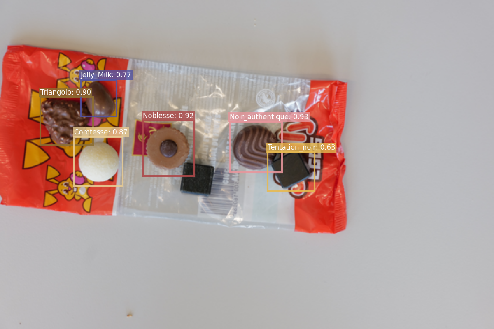

# Chocolate Recognition with a YOLOv2 Detector Built from Scratch

Final project for EPFL **EE-451 Image Analysis and Pattern Recognition** (2025) · Group 14: Niels Rigaud, Caspar Henking, Aksel Acar

The task was to detect, classify and count 13 types of chocolates in high-resolution photos (6000×4000) with cluttered backgrounds, distractor objects and partial occlusions, using only **90 training images** and one reference image per class. Models were limited to 12 M trainable parameters.

**Result:** a YOLOv2-style detector implemented in PyTorch with **1.2 M parameters**, which beat the course baseline on the Kaggle leaderboard with a best score of **0.933**.

<p align="center">
  
</p>
<p align="center"><em>Predictions of the final model on a difficult validation image</em></p>

The full write-up, with figures for every step, is in [`project/report_IAPR_group14.ipynb`](project/report_IAPR_group14.ipynb).

## Approach

**Annotation.** The course only provided per-image counts, but a detector needs bounding boxes. We labelled every chocolate by hand in VGG Image Annotator and converted the boxes to YOLO format (normalised centre, width, height, class).

**Anchors from data.** We ran K-Means on all ground-truth boxes to pick 9 anchor shapes. On average, each box overlaps its closest anchor with an IoU of 0.94, so the network only has to refine a nearby anchor instead of predicting box sizes from scratch.

**Model.** The network is a single-scale YOLOv2-style detector: a convolutional backbone (Conv, BatchNorm, SiLU) downsampling by 16, a light head with dropout, and a prediction layer that outputs a 24×36 grid × 9 anchors × (5 + 13 classes). Images are kept at their 3:2 aspect ratio (576×384) rather than squashed to a square, so chocolates aren't distorted differently depending on their orientation. The objectness bias is initialised to about 0.01 after the sigmoid to limit early false positives.

**Loss.** Four weighted terms:
- box regression (MSE on sigmoid offsets and log-scale sizes relative to the anchors);
- objectness, trained towards the IoU between predicted and true boxes;
- a no-object BCE term that suppresses false positives;
- cross-entropy for the class.

**On-the-fly augmentation.** Random flips, rotations and translations (with box updates and removal of boxes that leave the image), colour jitter, Gaussian or box blur, and Gaussian and salt-and-pepper noise. New augmentations are drawn at every epoch.

**Post-processing.** Final confidence = objectness × top class probability. Predictions below 0.75 are discarded, then non-maximum suppression removes duplicate boxes, and the remaining detections are counted per class.

## What made the difference

The first model used close to the 12 M parameter limit and reached only about 30% F1 on the test set. Adding noise augmentation brought it to about 60%. Adding dropout jumped it to about 80%, which showed the model was memorising the training photos. Shrinking the network about 10× (to 1.2 M parameters) is what finally passed the baseline. With this little data, the smaller model generalised better.

## Repository structure

```
project/
├── main.py                          # training (commented out) and inference → submission.csv
├── report_IAPR_group14.ipynb        # full report
└── src/
    ├── Constants.py                 # image size, hyperparameters, paths
    ├── Dataset.py                   # dataset and YOLO target construction
    ├── Data_Augmentation.py         # on-the-fly augmentations with box updates
    ├── NN_Model.py                  # YOLOv2-style network and weight initialisation
    ├── Loss.py                      # four-term YOLO loss
    ├── Inference_test.py            # post-processing, NMS and submission
    ├── utils.py                     # IoU, checkpoints, visualisation
    ├── Anchors/                     # K-Means anchor computation and results
    ├── Annotations_and_labels/      # hand-made annotations and YOLO label files
    ├── Model_checkpoints/           # trained model (epoch 472)
    └── Images_report/               # figures used in the report
labs/                                # course lab notebooks
```

## Running

The competition images are not included. Put the dataset folder `dataset_project_iapr2025/` (with `train/` and `test/`) inside `project/`, then:

```bash
cd project
pip install -r requirements.txt
python main.py
```

`main.py` loads the trained checkpoint and writes `submission.csv` for the test images. The training code is in the same file but commented out.

## Credits

Our implementation started from a [YOLOv3-from-scratch tutorial](https://www.geeksforgeeks.org/yolov3-from-scratch-using-pytorch/). We removed the multi-scale parts, adapted everything to non-square inputs and rewrote most functions. Only a few utilities (IoU, checkpoint saving and loading, and parts of the dataset and loss classes) are close to the original. Method reference: Redmon & Farhadi, [YOLO9000: Better, Faster, Stronger](https://arxiv.org/abs/1612.08242).
